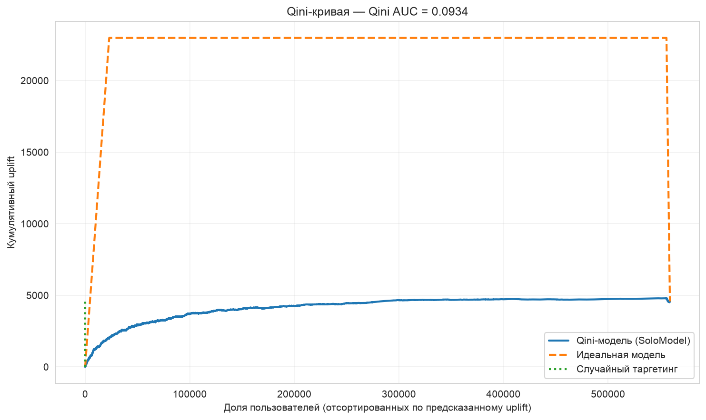
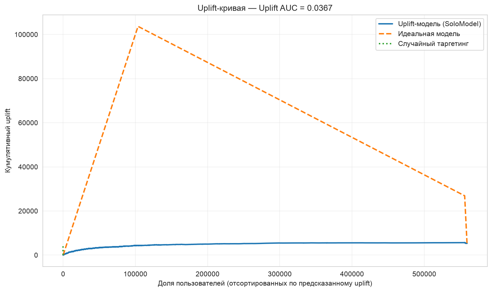
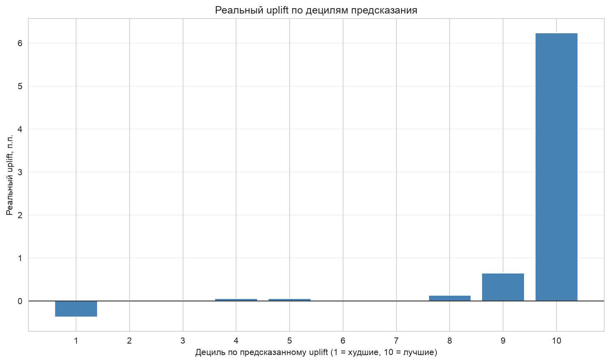

# Criteo Uplift Modeling

Изучила, как реклама влияет на поведение пользователей, и построила модель, которая помогает находить аудиторию с наибольшим эффектом от рекламы.

## Данные

25 млн строк и 12 признаков. Для анализа использовала стратифицированную подвыборку из 2,8 млн строк.

Датасет в репозиторий не входит.

## Что сделала

- Провела EDA и SRM-тест.
- Сравнила контрольную и тестовую группы.
- Построила S-learner на CatBoost.
- Оценила модель с помощью Qini AUC, Uplift AUC и анализа децилей.

## Результаты

- **A/B-тест:** visit rate — 3,84% в контрольной группе и 4,83% в тестовой. Разница статистически значима (`p-value < 1e-170`).
- **Qini AUC:** 0,093.
- **Uplift@30%:** 2,86%.
- **Топ-10% аудитории:** uplift 6,24 п.п. В большинстве остальных децилей эффект близок к нулю, а в первом — отрицательный.

## Вывод

Эффект рекламы различается между пользователями. Модель помогает выделить аудиторию, на которой реклама даёт наибольший прирост визитов, и точнее распределять рекламный бюджет.

## Графики

## Стек

Python, pandas, CatBoost, scikit-learn, SciPy, matplotlib.